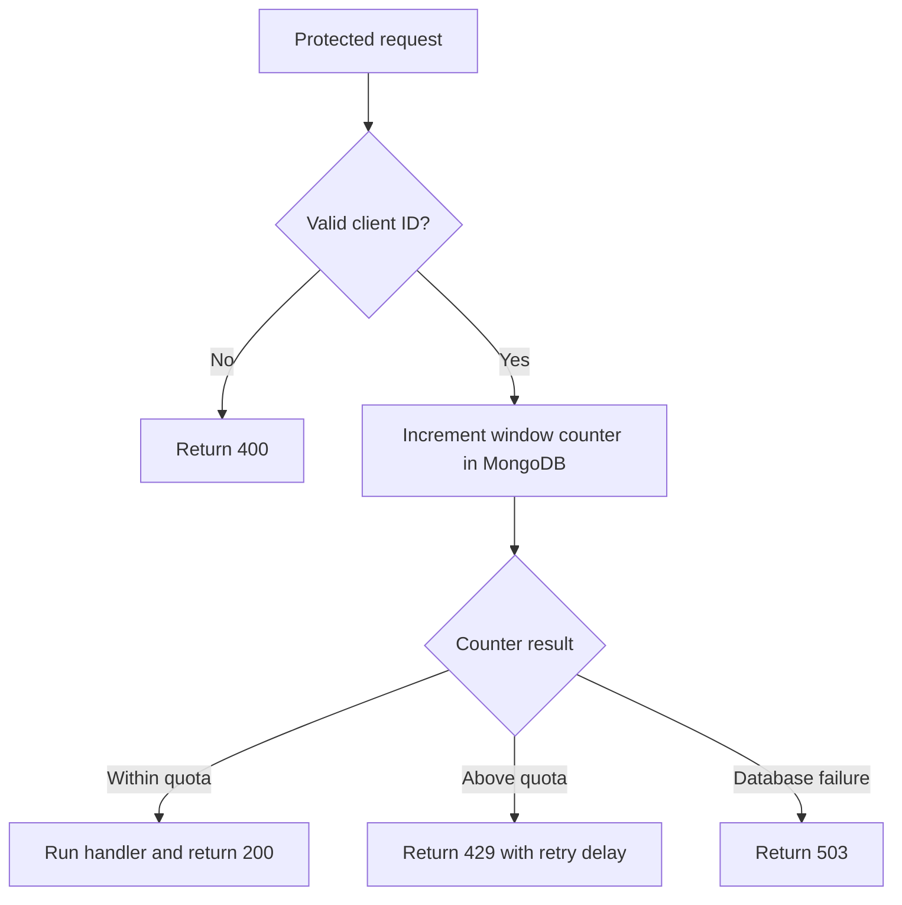

# Question 2 | Rate limiter architecture

## Stack and boundaries

The backend uses Python with FastAPI and PyMongo and applies the MongoDB document model selected for Question 1. FastAPI handles the HTTP interface. The limiter determines the client and time window and evaluates quota. The MongoDB store owns counter updates and expiry. One application process and one local MongoDB instance are enough for the demonstration. Multiple application processes can share counters when they use the same database, policy settings, and synchronized system clocks.

Invalid client identifiers return HTTP 400 at validation. The readiness route checks database connectivity and ensures the counter index is ready. The application also attempts index setup at startup. If MongoDB is down at startup, requests can report HTTP 503 and index setup is retried when the database is reachable.

## Document model

The collection is named `rate_limit_counters`. It stores one document per combination of policy, client, and fixed window.

| Field | Type | Purpose |
|---|---|---|
| `_id` | String | Unique identity formed from the policy identifier, validated client ID, and window start using an unambiguous separator. |
| `count` | Integer | Total valid attempts recorded in this window, including denied attempts. |
| `expiresAt` | UTC date | Window end plus 60 seconds of cleanup grace. A single-field TTL index removes expired documents. |

Use the built-in unique identifier index to target a single counter. The store uses an acknowledged `find_one_and_update` with `$inc`, `upsert=True`, and `ReturnDocument.AFTER` to increment and return the new count atomically. `$setOnInsert` sets the expiry only when inserting the counter. Quota reset follows the window in the identifier, so a delayed TTL deletion does not delay reset. If the initial insert loses a race on this identifier and the database explicitly returns a duplicate-key error, retry once as an update of the same document. Avoid application-level retries after ambiguous write outcomes because the attempt may already count.

## Trust and failure decisions

The local demonstration accepts a client-supplied identifier for reproducible tests. It can be changed by the caller, so public deployment would require a trusted identity taken from authentication. Bind the demo to localhost and keep the database URI out of source control and logs. Return 503 when the database cannot provide a quota decision. Use a finite database deadline. The quota and window duration are part of the policy identifier so different configurations use separate counters.

## MongoDB references

- [Single-document write atomicity](https://www.mongodb.com/docs/manual/core/write-operations-atomicity/)
- [TTL indexes and document expiration](https://www.mongodb.com/docs/manual/tutorial/expire-data/)
- [PyMongo operation deadlines](https://www.mongodb.com/docs/languages/python/pymongo-driver/current/connect/connection-options/csot/)
